# Front door

## Title

**The title: the Wayfarer's mark over WAYFARER in gilt letters, the Last Camp at dawn turning behind the stamp's buttons, no splash text and no Realms**, in the showroom

| Scale 2 | Scale 3 | Scale 4 |
| --- | --- | --- |
| 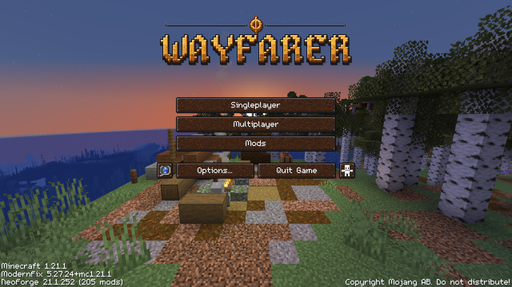 | 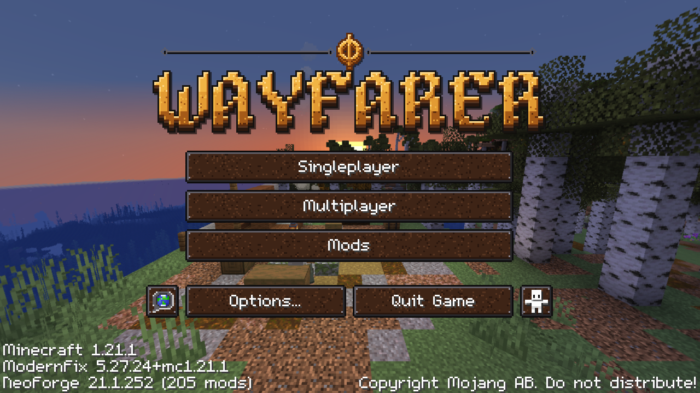 | 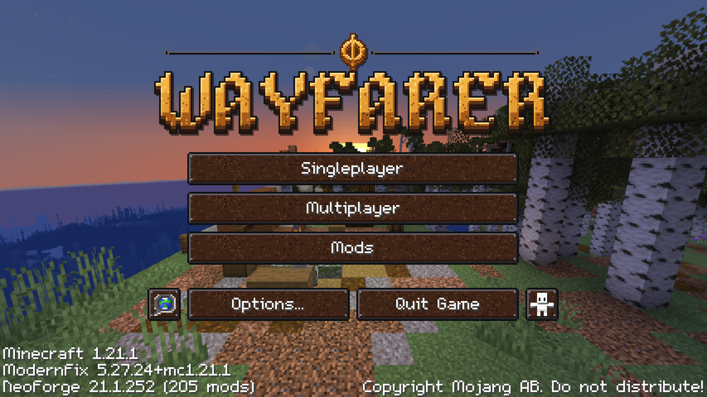 |

## Loading

**Loading a world: the last page of the story so far on the journal's parchment over the dimmed panorama, with vanilla's progress line under it**, in the story at `the_pull/the_fireside`

| Scale 2 | Scale 3 | Scale 4 |
| --- | --- | --- |
| 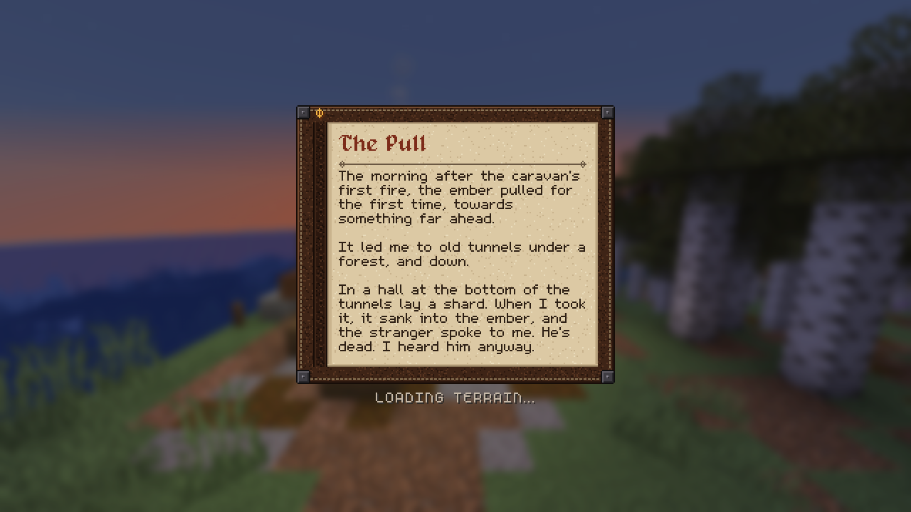 | 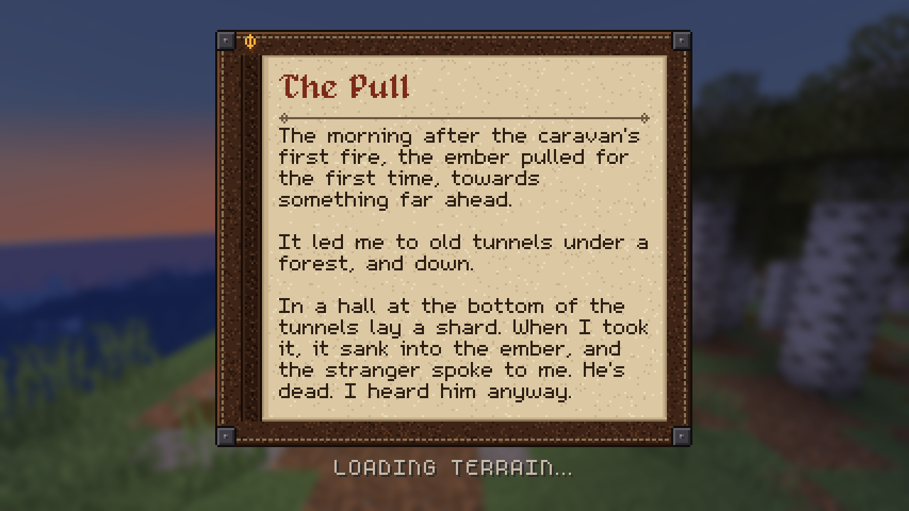 |  |

## Loading first

**Loading a new world, or a server joined for the first time: the line that leads into the first scene**, in the showroom

| Scale 2 | Scale 3 | Scale 4 |
| --- | --- | --- |
| 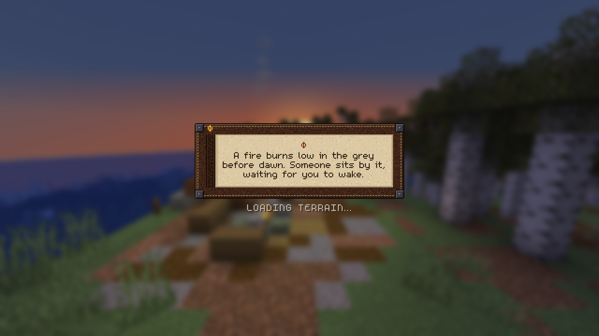 |  | 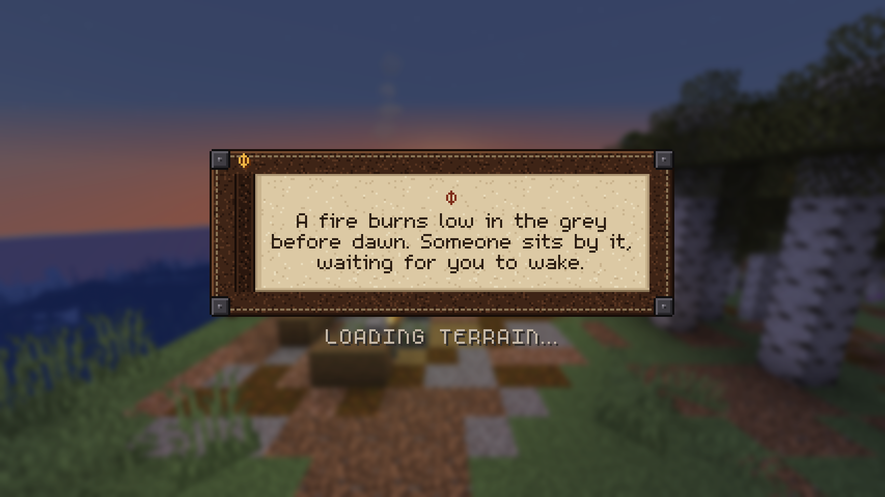 |

## Create world

**Create New World opens on Survival, Normal difficulty and commands off**, in the showroom

| Scale 2 | Scale 3 | Scale 4 |
| --- | --- | --- |
| 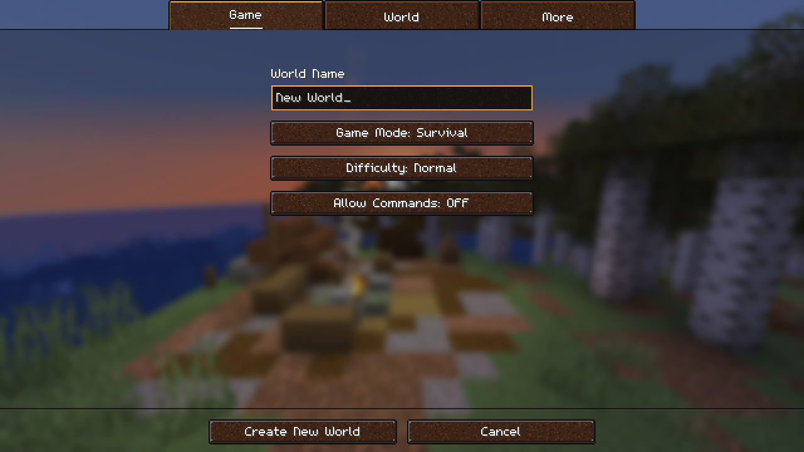 | 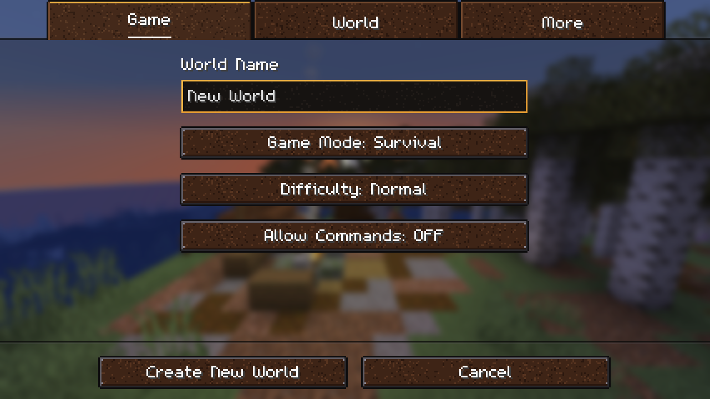 |  |

## Create world land

**Create New World's World tab: the pack's land, with vanilla's options where they always are**, in the showroom

| Scale 2 | Scale 3 | Scale 4 |
| --- | --- | --- |
| 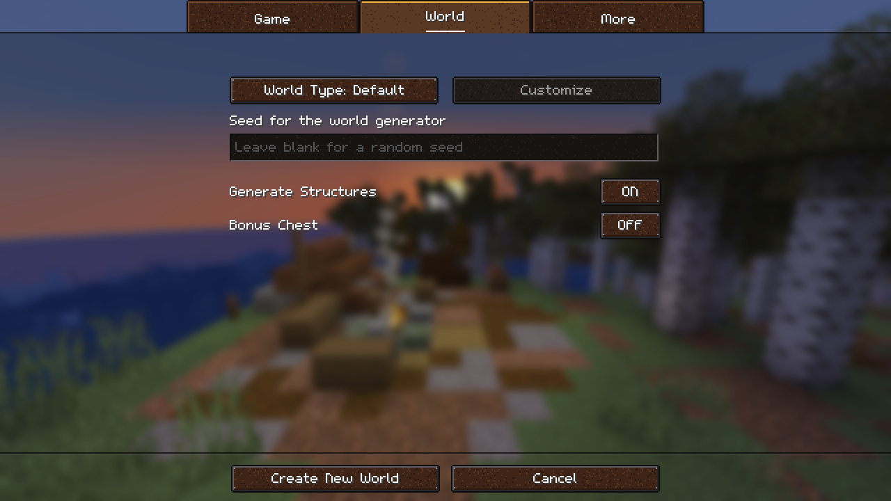 | 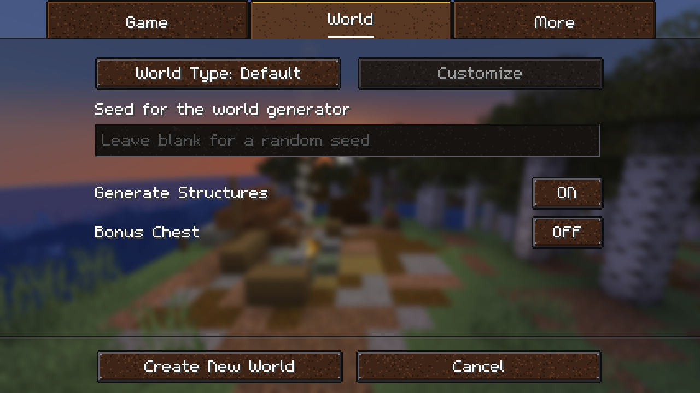 |  |

## Pause

**The pause menu: Journal and Map where Advancements and Statistics stood**, in the showroom

| Scale 2 | Scale 3 | Scale 4 |
| --- | --- | --- |
| 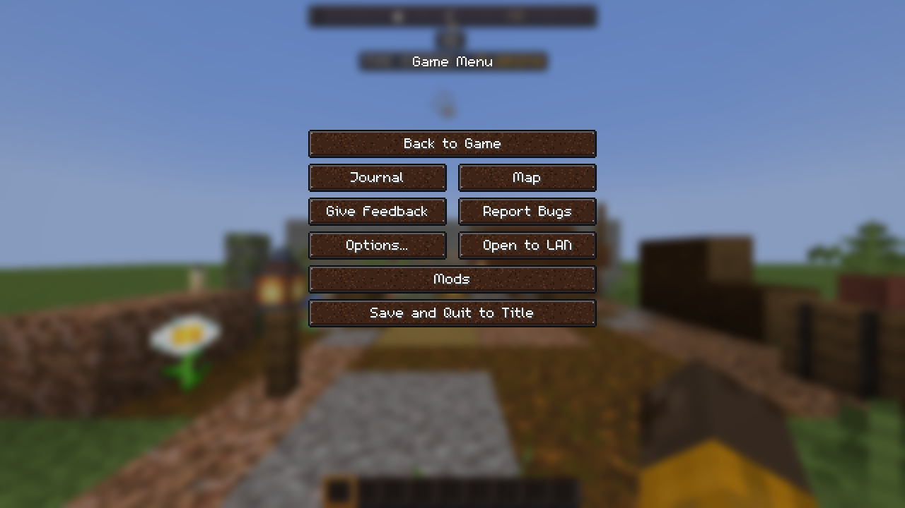 | 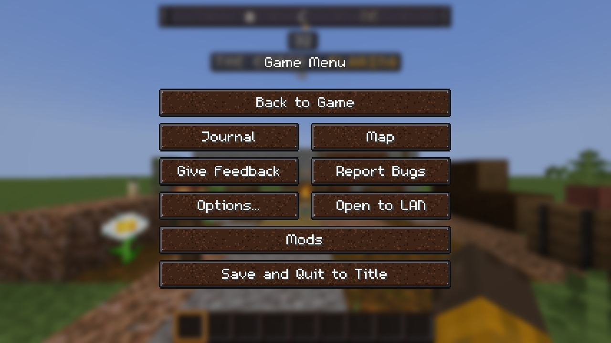 | 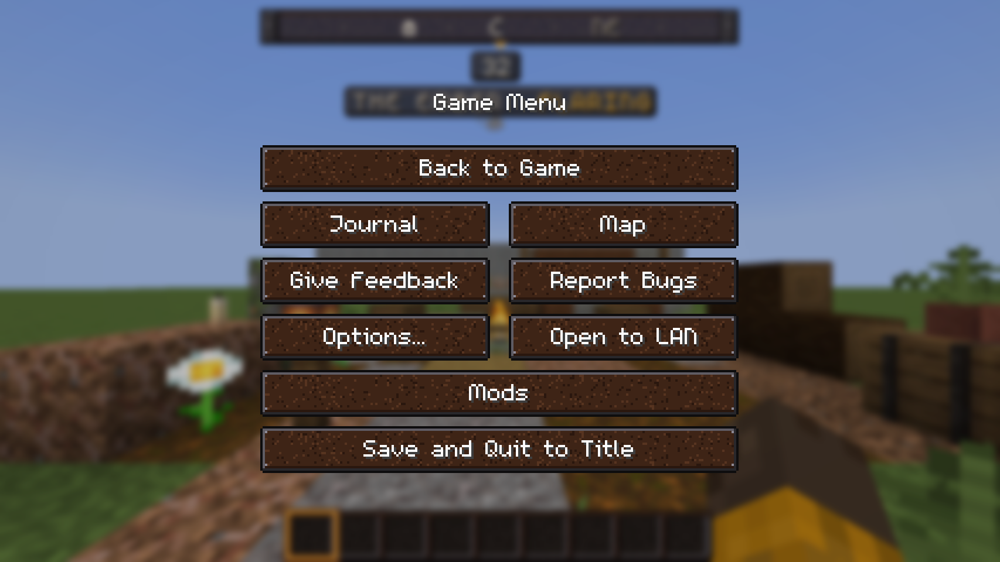 |
