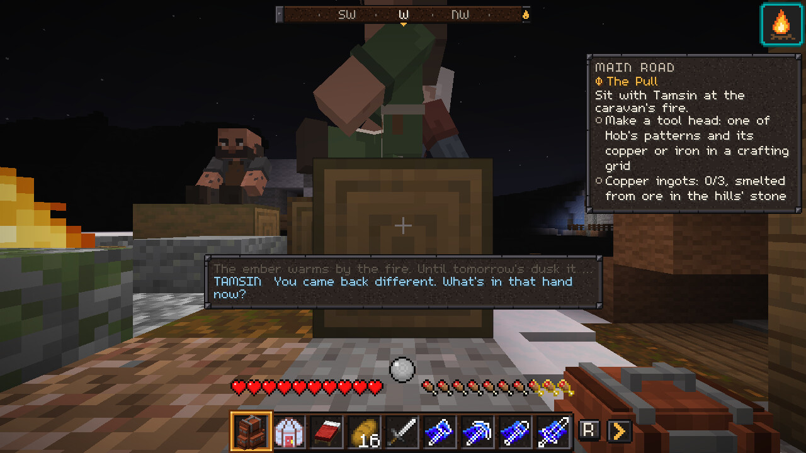
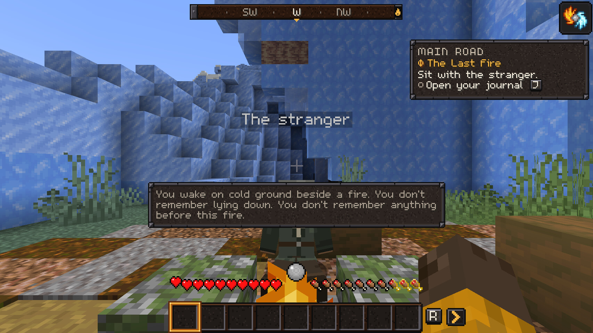
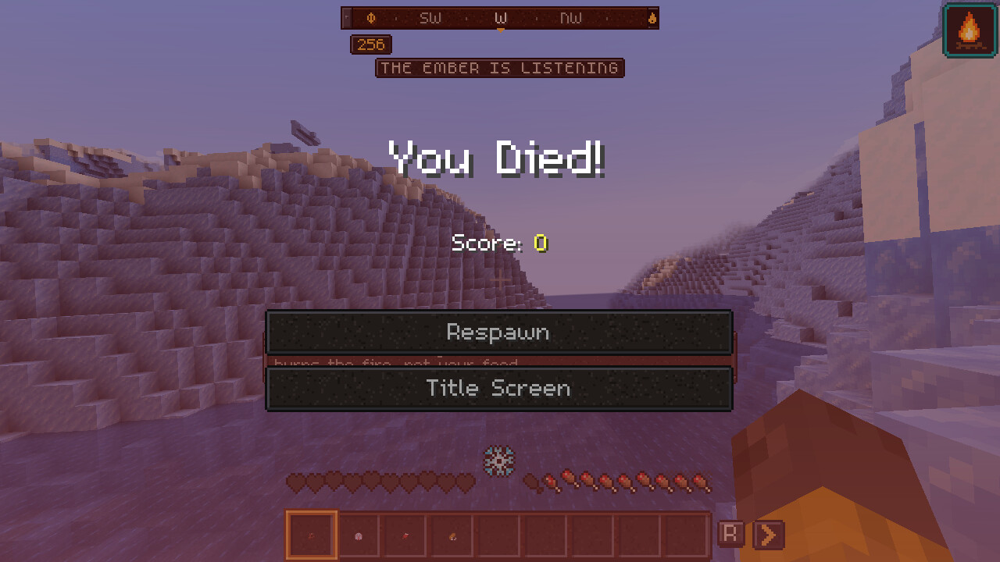
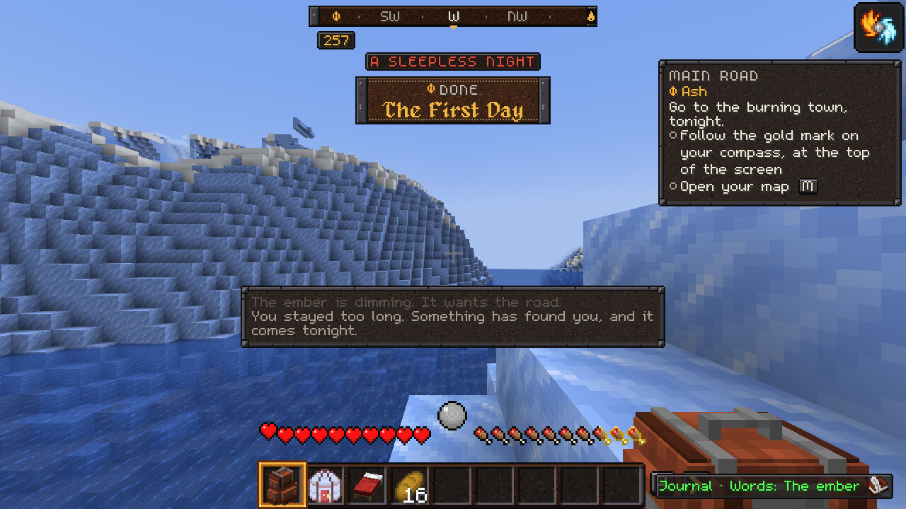
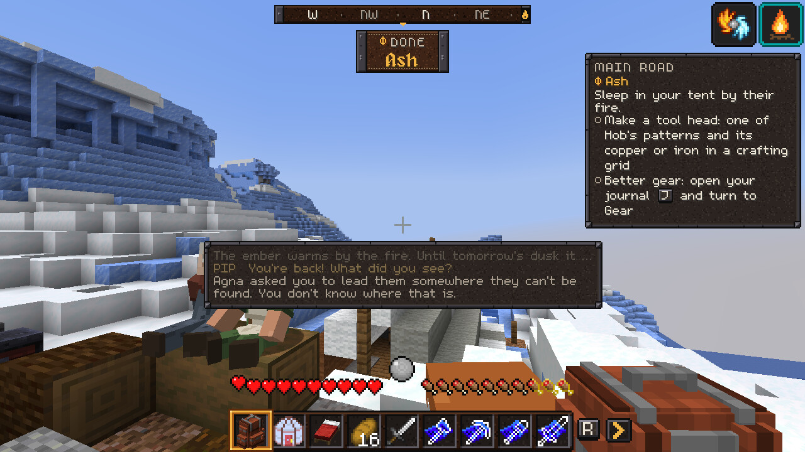
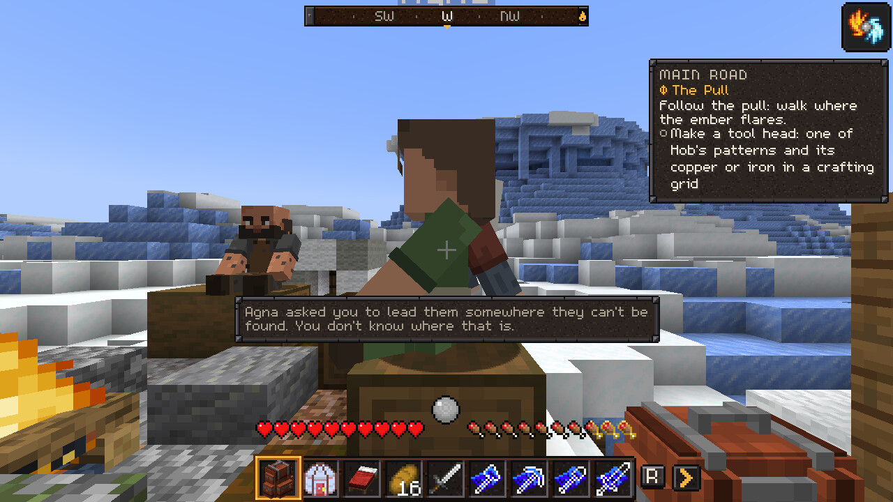
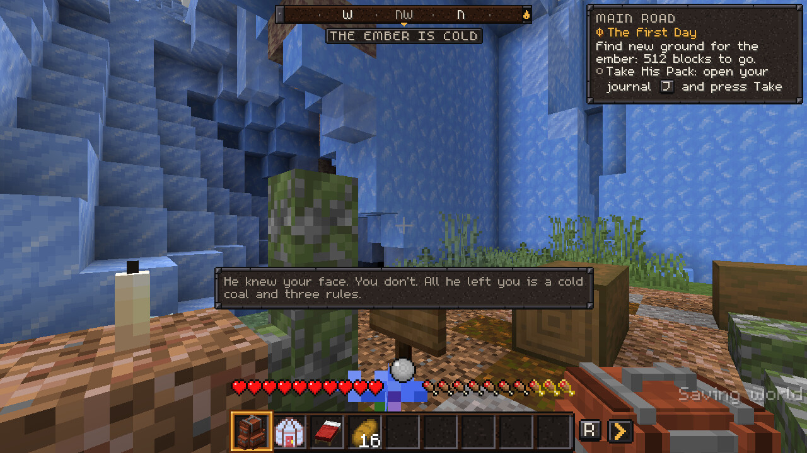
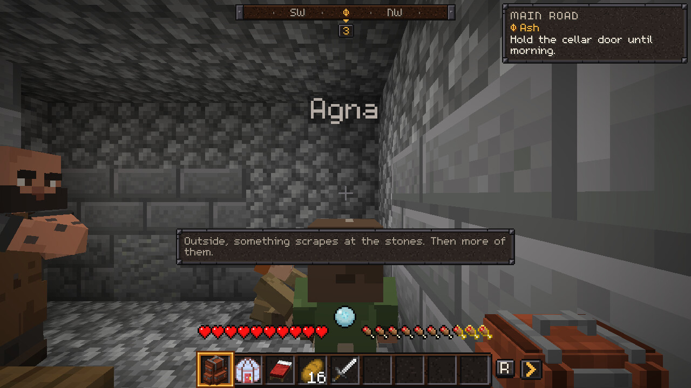
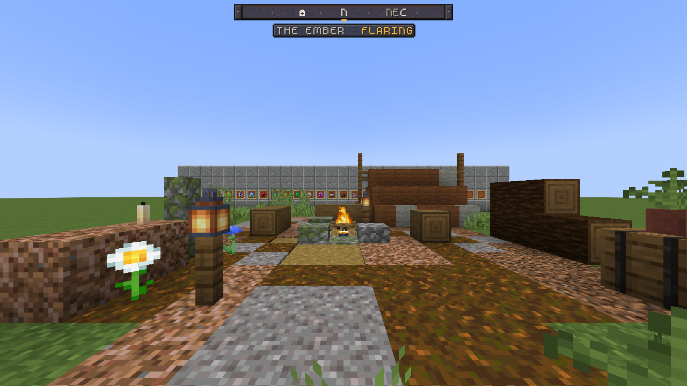
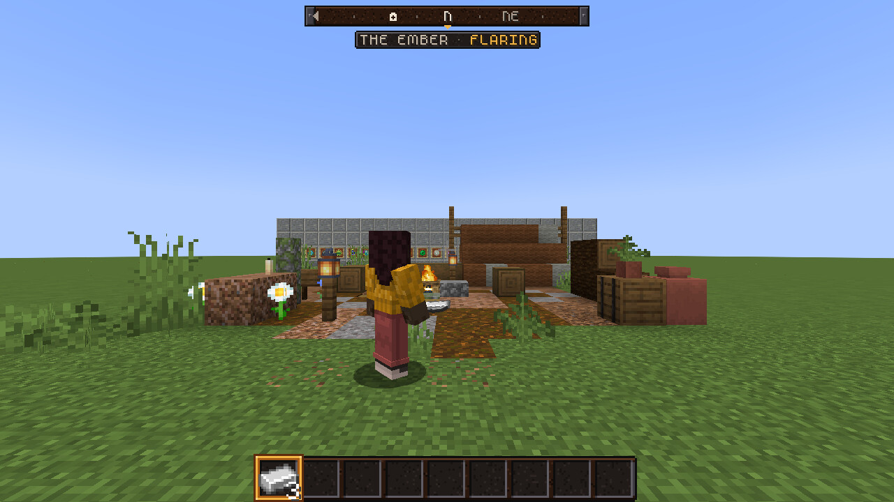

# HUD

## Gear first

**The first time Gear has a row: the task panel says where it is**, in the story at `the_pull/the_fireside`

## Gear tracked

**Copper tools tracked: their materials counted, then the making**, in the story at `the_pull/the_fireside`

## First night

**Waking at the stranger's fire: the task panel and the compass band**, in the story at `the_last_fire/the_stranger`

| Scale 2 | Scale 3 | Scale 4 |
| --- | --- | --- |
|  |  |  |

## Goal distance

**Making for the smoke: the tracked goal's mark with its distance under it**, in the story at `ash/the_town`

## Banner begun

**A quest begun: the parchment banner under the compass**, in the story at `the_first_day/dusk`

| Scale 2 | Scale 3 | Scale 4 |
| --- | --- | --- |
|  |  |  |

## Banner done

**A quest done: the parchment banner as Ash ends**, in the story at `ash/night`

## Feeling

**Following the pull: no mark yet, the ember's feeling under the band**, in the story at `the_pull/pull`

## Reward waiting

**A reward waiting: the task panel keeps it until it is taken**, in the story at `the_first_day/away`

## The hold

**The hold at the bell tower's door**, in the story at `ash/the_door`

## Showroom compass

**The compass demo: a waymark, a companion circling the camp and the camp's grave**, in the showroom

## Shoulder view

**F5's first press: the camera over the player's shoulder, the crosshair still in the middle**, in the showroom

