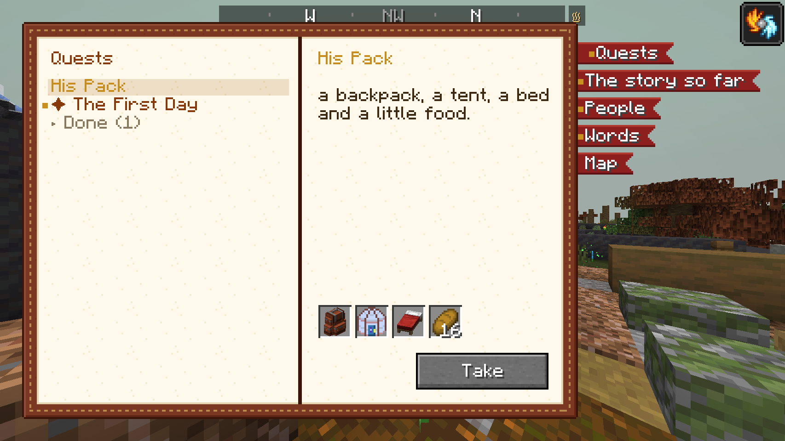
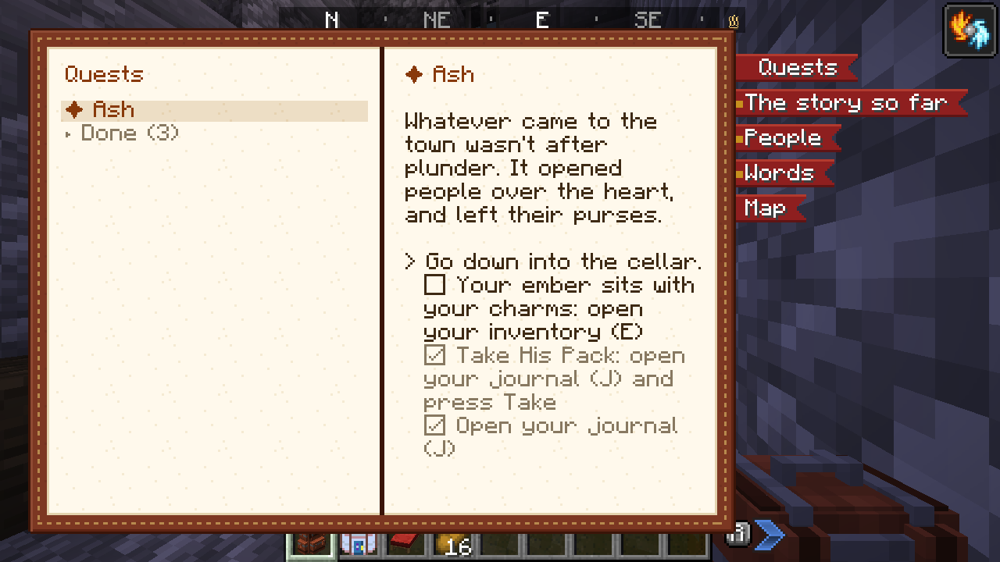
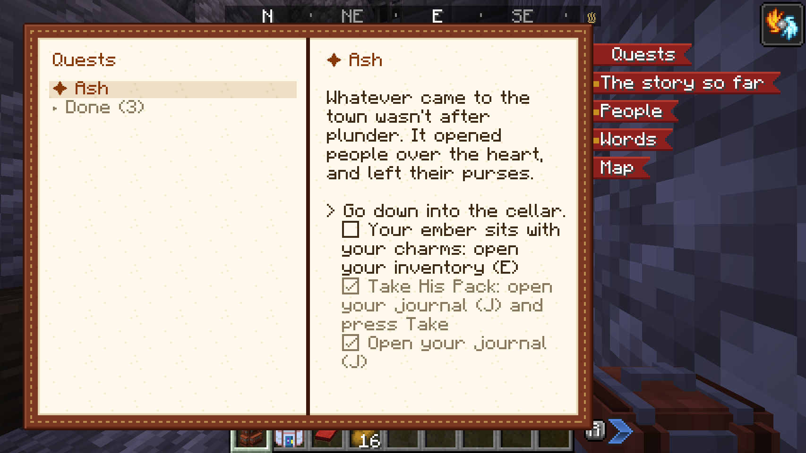
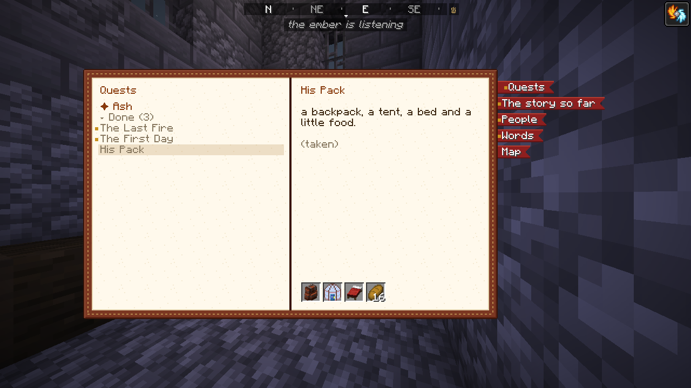
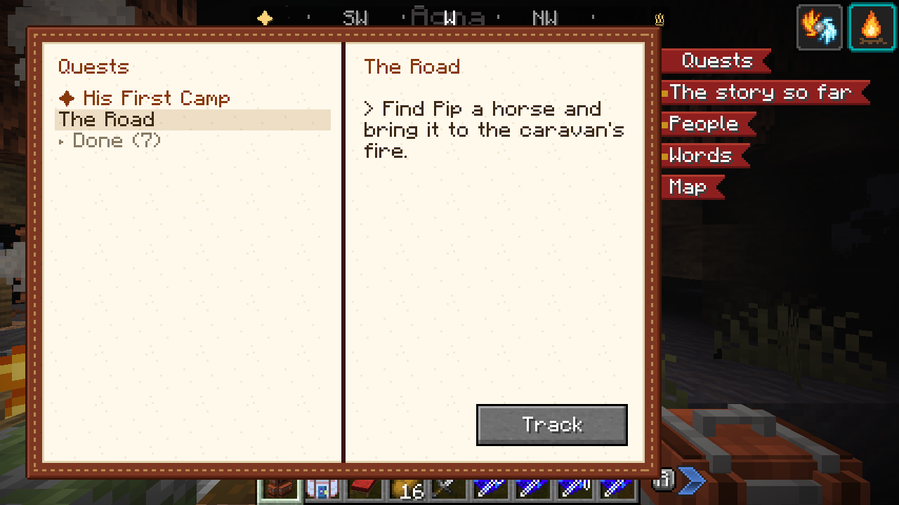
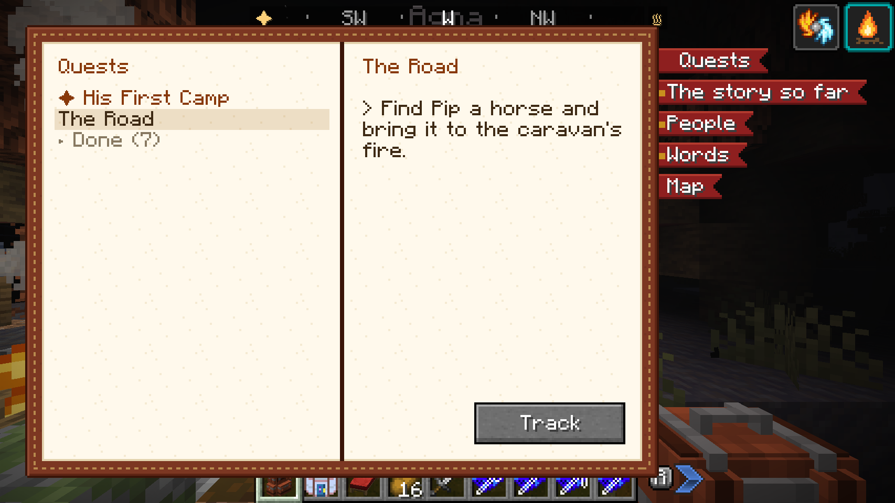
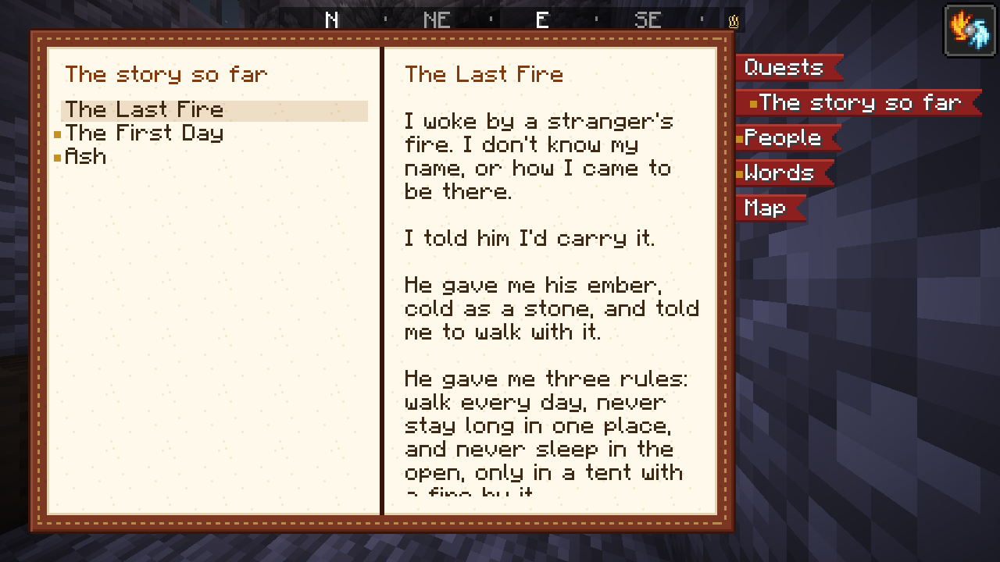
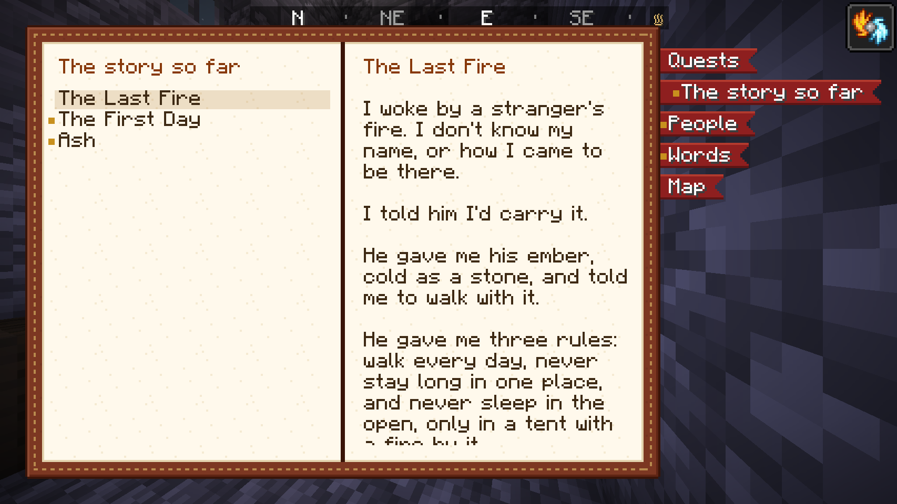
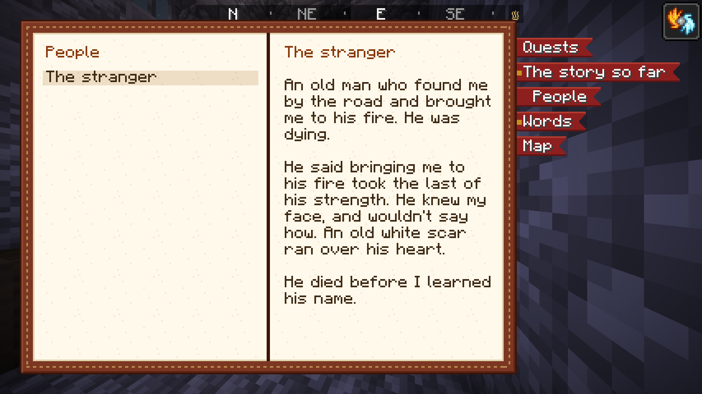
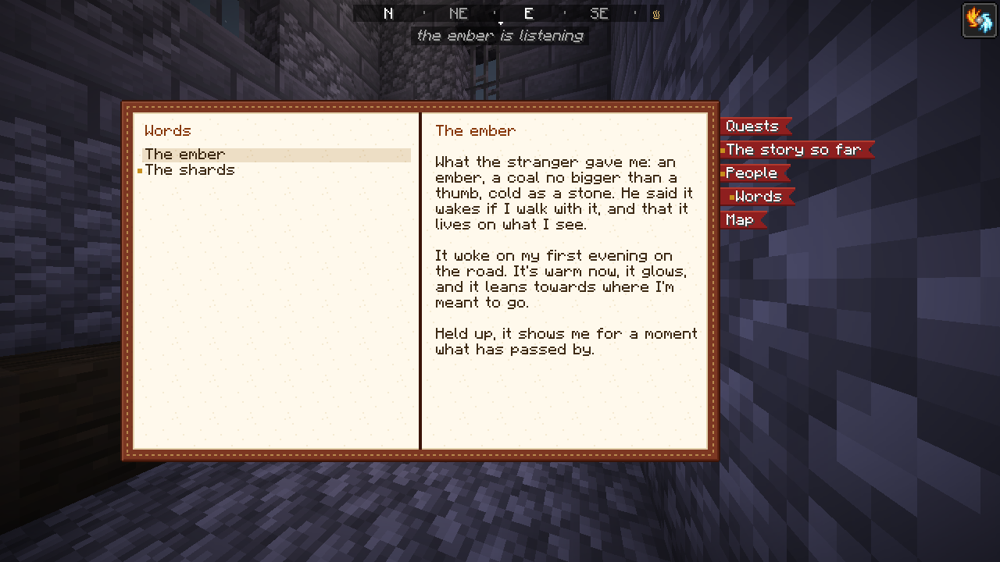

# Journal

## Quests

**The first night: only Quests, The story so far, People and the Map**, in the story at `the_last_fire/the_stranger`

| Scale 2 | Scale 3 | Scale 4 |
| --- | --- | --- |
|  |  |  |

**A reward waiting: first in the list, in gold, its items in slots and one Take**, in the story at `the_first_day/away`

| Scale 2 | Scale 3 | Scale 4 |
| --- | --- | --- |
|  |  |  |

**The tracked quest, with its story, objective and tasks**, in the story at `ash/the_cellar`

| Scale 2 | Scale 3 | Scale 4 |
| --- | --- | --- |
|  |  |  |

**Done quests unfolded, one of them chosen**, in the story at `ash/the_cellar`

| Scale 2 | Scale 3 | Scale 4 |
| --- | --- | --- |
|  |  |  |

**A reward already taken: its items still shown, no Take**, in the story at `ash/the_cellar`

| Scale 2 | Scale 3 | Scale 4 |
| --- | --- | --- |
|  |  |  |

**Side quests open beside the main quest, one chosen with its Track button**, in the story at `his_first_camp/the_lake`

| Scale 2 | Scale 3 | Scale 4 |
| --- | --- | --- |
|  |  |  |

## Story so far

**The story so far: one chapter per quest, told as I**, in the story at `ash/the_cellar`

| Scale 2 | Scale 3 | Scale 4 |
| --- | --- | --- |
|  |  |  |

## People

**People: the stranger, as the player knows him**, in the story at `ash/the_cellar`

| Scale 2 | Scale 3 | Scale 4 |
| --- | --- | --- |
|  |  |  |

## Words

**Words: the ember, as the player has learned it**, in the story at `ash/the_cellar`

| Scale 2 | Scale 3 | Scale 4 |
| --- | --- | --- |
|  |  |  |
