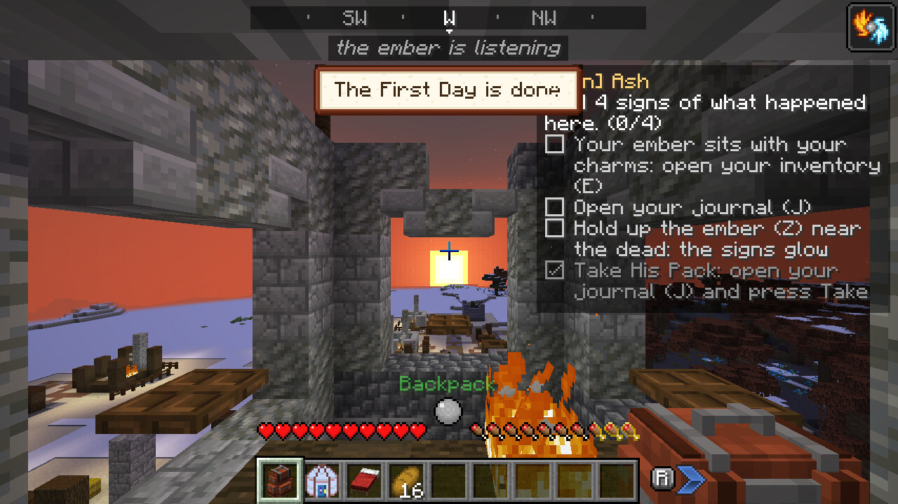
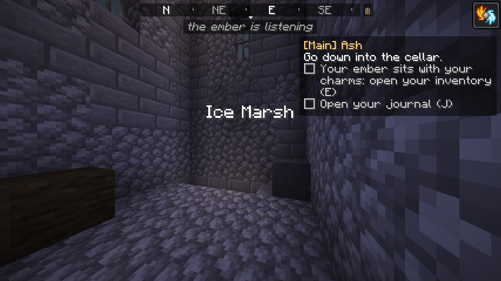
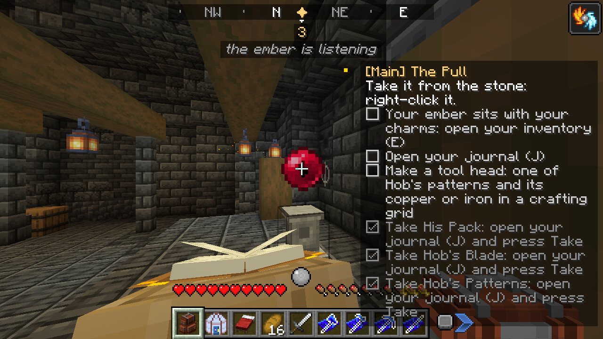
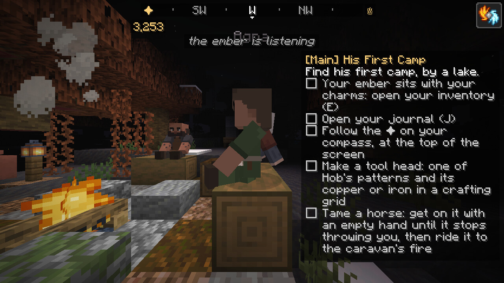

# Story

## The last fire

**The Last Camp at night: the stranger dying by his fire**, in the story at `the_last_fire/the_stranger`

**The stranger dead by his fire, before the burial**, in the story at `the_last_fire/the_grave`

## The first day

**Dusk on the first day: the smoke over the ridge**, in the story at `the_first_day/dusk`

## Ash

**Tollbridge burning at dusk**, in the story at `ash/the_town`

**Tollbridge's dead**, in the story at `ash/the_dead`

**The bell tower's cellar**, in the story at `ash/the_cellar`

**The caravan's first fire**, in the story at `ash/evening`

## The pull

**The Diggers' tunnels: the entrance in the hillside**, in the story at `the_pull/tunnels`

**The Diggers' hall: the shard on its stone**, in the story at `the_pull/shard`

**The caravan's camp in the evening**, in the story at `the_pull/the_fireside`

## His first camp

**The morning after the voice spoke: making for his first camp**, in the story at `his_first_camp/the_lake`

