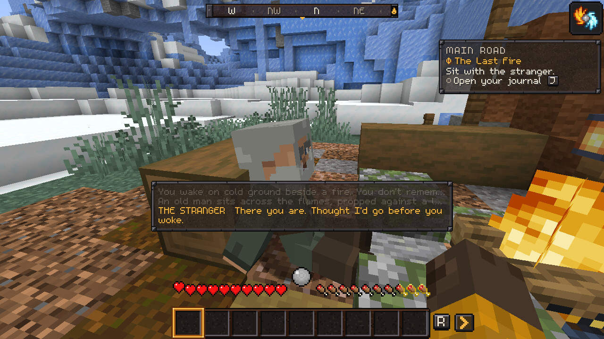
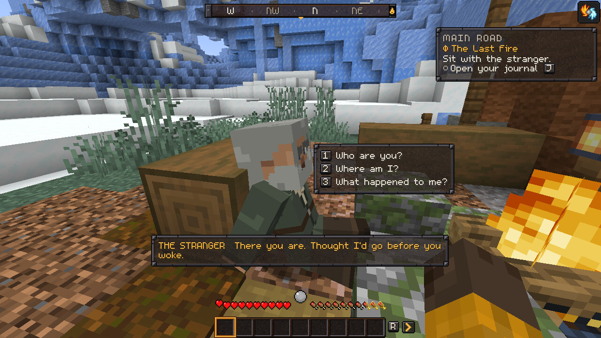
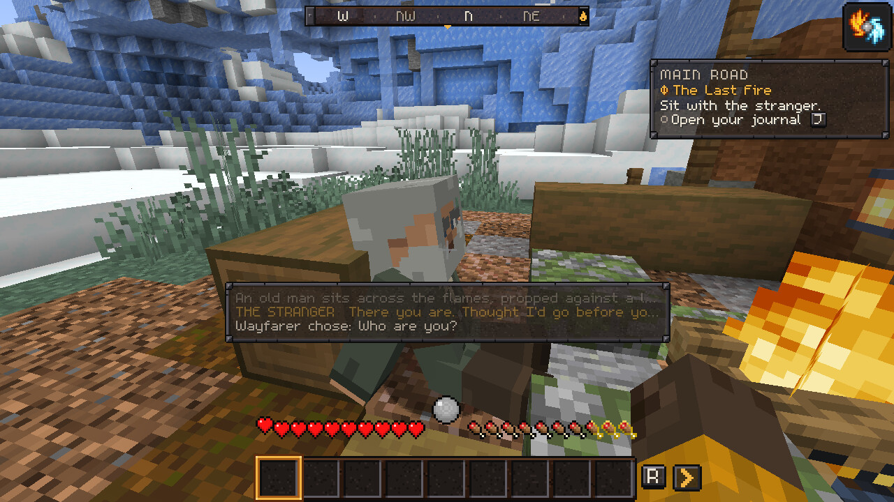
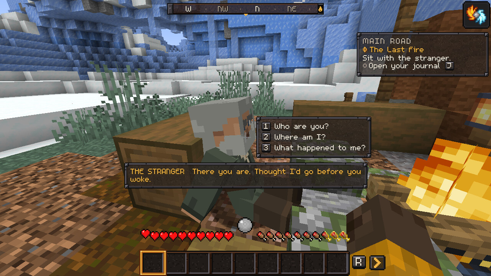
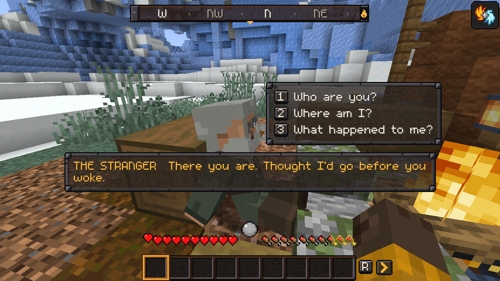
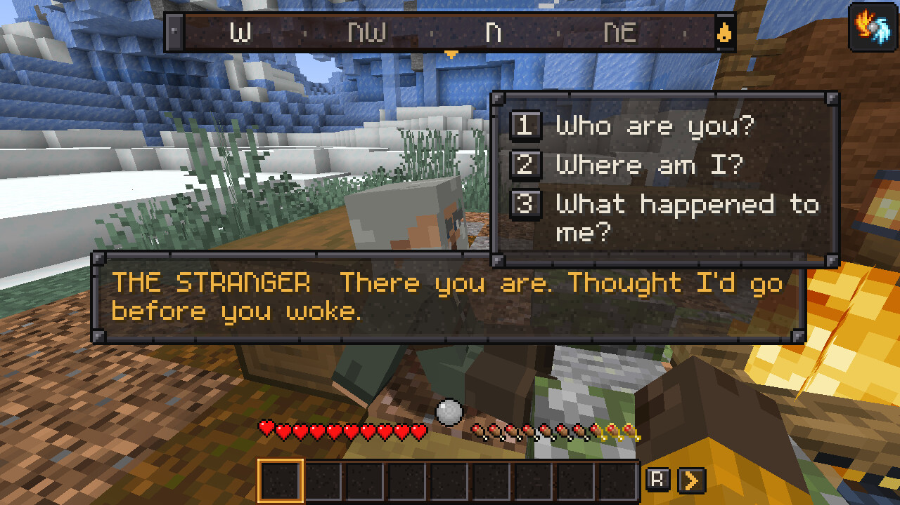
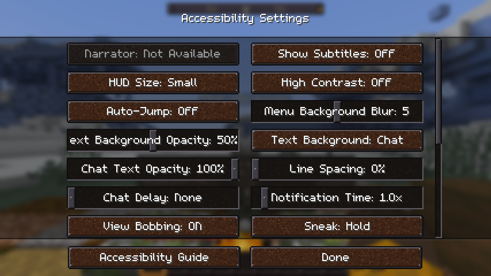
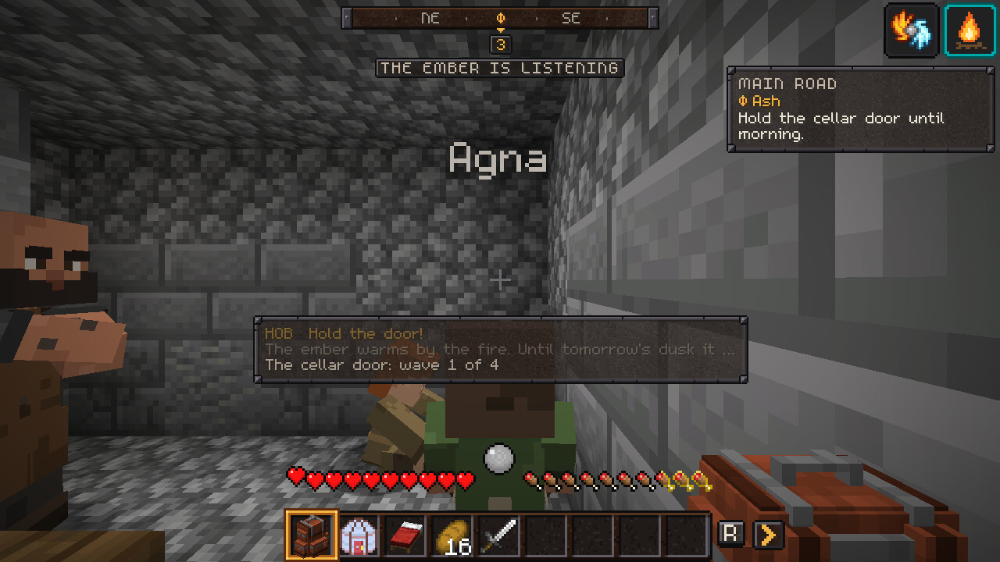
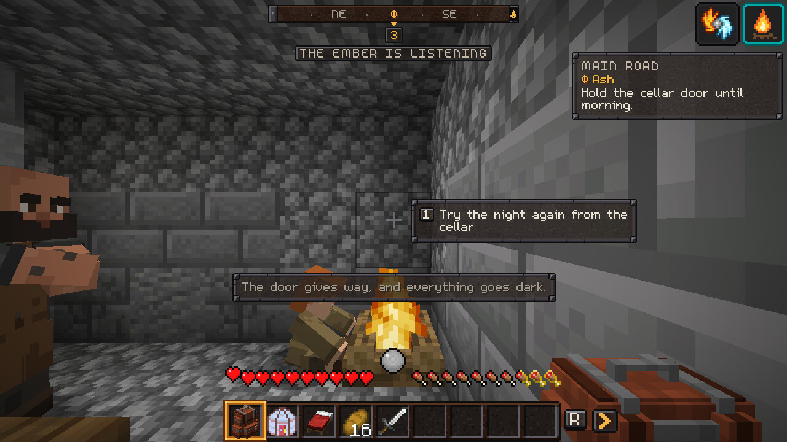

# Talk

## First line

**The stranger's first line on the band, the narrator's lines above it, nobody's answers yet**, in the story at `the_last_fire/the_stranger`

## Answers

**Answers numbered beside the crosshair; the task panel says to press a number, the first time**, in the story at `the_last_fire/the_stranger`

| Scale 2 | Scale 3 | Scale 4 |
| --- | --- | --- |
|  |  |  |

## Chose

**An answer pressed: who chose it shows on the band, the question faint above**, in the story at `the_last_fire/the_stranger`

## Small

**HUD Size: Small**, in the story at `the_last_fire/the_stranger`

## Normal

**HUD Size: Normal**, in the story at `the_last_fire/the_stranger`

## Large

**HUD Size: Large**, in the story at `the_last_fire/the_stranger`

## Size option

**Options, Accessibility Settings: HUD Size beside Show Subtitles**, in the story at `the_last_fire/the_stranger`

## Wave

**A notice on the band for everyone, wherever they are: the hold's first wave**, in the story at `ash/the_door`

## Retry

**The door lost: the notice, and trying the night again offered as an answer**, in the story at `ash/the_door`

